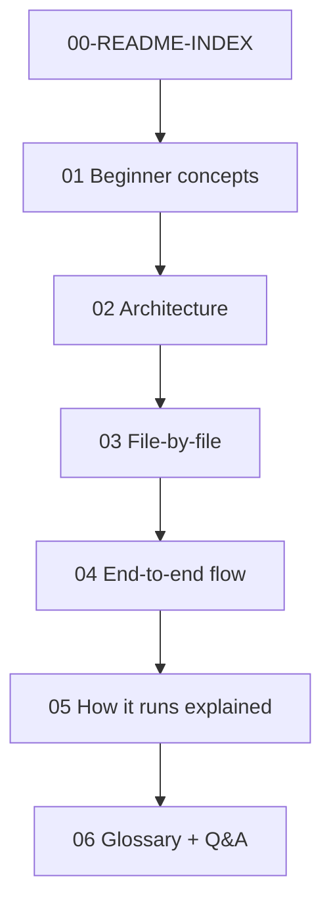

# TaxMesh Contract-Testing Demo — Analysis Index

**Repo analyzed:** `contract-testing-business-demo` (TaxMesh Form 1065 microservices)  
**Mode:** Explain-only / read-only (no installs, builds, or test runs)  
**Created:** `docs-analysis/` (analysis artifacts only)

---

## How to read these files

| Order | File | Read when you want… |
|-------|------|---------------------|
| 0 | `00-README-INDEX.md` | Map of the pack + Phase 1 discovery table |
| 1 | `01-beginner-concepts.md` | What contract testing is **in this repo** |
| 2 | `02-architecture.md` | Services, deps, diagrams |
| 3 | `03-file-by-file-guide.md` | Every important file + deep dives |
| 4 | `04-end-to-end-flow.md` | Lifecycle, happy/fail paths, sample CT |
| 5 | `05-how-it-runs-explained.md` | Commands explained (**not executed**) |
| 6 | `06-glossary-and-qna.md` | Terms, interview Qs, 2-min pitch |

**Tip:** Prefer tables and Mermaid diagrams; use prose only as captions.

---

## One-line verdict

| Question | Answer |
|----------|--------|
| What is this? | Node/Express **TaxMesh** demo: 6 microservices + gateway for Form **1065** |
| Contract tool? | **Custom** shape checker — **not** Pact / Spring Cloud Contract |
| How verified? | `npm run test:contracts` → `contracts/run-contracts.js` HTTP GETs producers |
| Broker / CI gate? | **Not found in repo** |

---

## Phase 1 discovery table (full)

| Item | Found | Evidence (file path) |
|------|-------|----------------------|
| Language | JavaScript (Node.js) | `package.json`, `**/*.js` |
| Package manager | npm | `package.json`, `package-lock.json` |
| Runtime (container) | Node 20 Alpine | `Dockerfile` |
| Web framework | Express ^4.21.2 | `package.json` |
| Contract testing tool | Custom runner | `contracts/run-contracts.js` |
| Pact library | **Not found** | no dependency / import |
| Spring Cloud Contract | **Not found** | no Java/Maven |
| Pact Broker | **Not found** | — |
| can-i-deploy | **Not found** | — |
| Jest / Mocha / JUnit | **Not found** | only `test:contracts` |
| CI (GitHub Actions, Jenkins) | **Not found** | no workflow files |
| Docker | Yes | `Dockerfile`, `docker-compose.yml` |
| Frontend | Vanilla SPA | `frontend/` |
| OpenAPI / Swagger | Yes | `swagger-ui-express`, `shared/openapi.js` |
| Demo data | Excel sets | `testdata/set-01` … `set-05` |
| Domain docs | Yes | `README.md`, `docs/ARCHITECTURE.md`, `CASE_STUDY.md` |

---

## Repo tree + purpose

| Path | One-line purpose |
|------|------------------|
| `services/` | Microservice entrypoints (CLM…DOC + alias folders) |
| `gateway/` | Port 4100 — UI host, proxy, filing, Swagger |
| `frontend/` | Browser SPA |
| `shared/` | Contracts, payloads, service factory, filing engine |
| `contracts/` | Contract verification runner |
| `testdata/` | Demo Excel uploads |
| `docs/` | Human architecture/API manuals |
| `postman/` | API collection |
| `scripts/` | start-all + generators |
| `docker-compose.yml` | Multi-container run |
| `docs-analysis/` | **This** teaching pack |

---

## Phase gate checklist

| Gate | Topic | Status |
|------|-------|--------|
| 1 | Discovery / tech stack | Complete (table above) |
| 2 | Beginner concepts mapped to repo | See `01-…` |
| 3 | Architecture boxes → real files | See `02-…` |
| 4 | Important files documented | See `03-…` |
| 5 | Flows match code/test names | See `04-…` |
| 6 | Commands explained, not executed | See `05-…` |
| 7 | Glossary + uncertainties | See `06-…` |

---

## Related upstream docs (already in repo)

| File | Use |
|------|-----|
| `README.md` | Quick start |
| `docs/ARCHITECTURE.md` | Official architecture |
| `docs/API.md` | API reference |
| `CASE_STUDY.md` | Case-study brief |
