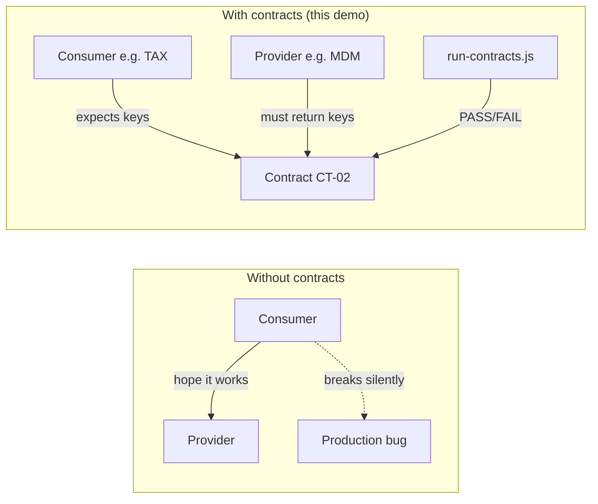
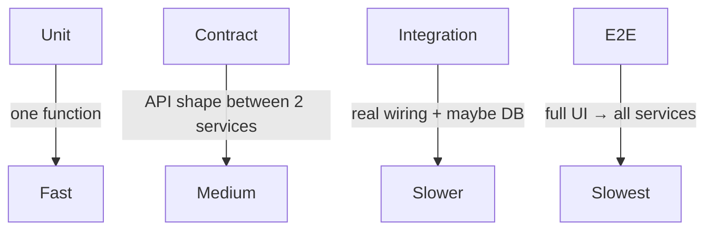
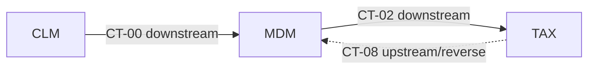
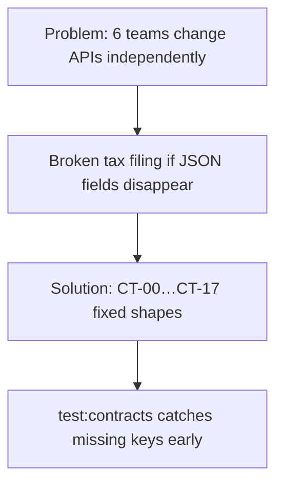

# 01 — Beginner Concepts (mapped to THIS repo)

> Evidence paths are relative to `contract-testing-business-demo/`.

---

## 1. What is contract testing?

**Idea:** Two services agree on a **message shape** (fields + meaning). Tests check that shape **without** spinning up the full real stack every time.

| Question | Answer in THIS repo |
|----------|---------------------|
| What is the “contract”? | JSON **payload shape** for CT-00…CT-17 in `shared/payloads.js` + metadata in `shared/contracts.js` |
| How is it checked? | `contracts/run-contracts.js` → `check(ct)` fetches producer URL, asserts `contractId` + `requiredKeys` |
| Is it Pact / Spring Cloud Contract? | **No** — custom Node runner (Not found: `pact`, broker, can-i-deploy) |

---

## 2. Why it exists (vs Integration vs E2E)

| Type | What it proves | Speed | Cost when it fails | In THIS repo? |
|------|----------------|-------|--------------------|---------------|
| **Unit** | One function works | Fast | Cheap | **Not found** (no Jest/Mocha) |
| **Contract** | Producer JSON has expected keys / `contractId` | Fast-ish | Cheap | **Yes** — `npm run test:contracts` → `contracts/run-contracts.js` |
| **Integration** | Services + shared store/filing talk correctly | Medium | Medium | **Partial** — filing APIs / uploads (`gateway/filingRoutes.js`, `shared/filingEngine.js`) act as demo integration, not a separate test suite |
| **E2E** | User journey in UI to e-file | Slow | Expensive | **UI demo** (`frontend/`) — not an automated E2E suite |

---

## 3. Core terms — only what THIS repo uses

| Term | Simple meaning | Used here? | Evidence |
|------|----------------|------------|----------|
| **Consumer** | Service that **reads** another’s data | Yes | `CONTRACTS[].consumer` in `shared/contracts.js` |
| **Producer / Provider** | Service that **exposes** the JSON | Yes | `CONTRACTS[].producer`; routes in `shared/createService.js` |
| **Contract / Pact file** | Agreement on shape | Yes (as JS objects, not `.json` pact files) | `shared/payloads.js` `PAYLOADS`, `shared/contracts.js` `CONTRACTS` |
| **Broker** | Central store for contracts | **Not found in repo** | — |
| **Provider verification** | Provider proves it still matches consumer contracts | **Partial / custom** | Runner hits live producer HTTP endpoints (`run-contracts.js` `check`) |
| **Mocks / Stubs** | Fake responses | **In-memory samples** | Producers return `PAYLOADS[ct.id]` from `createService.js` |
| **can-i-deploy** | Deploy safety check via broker | **Not found in repo** | — |
| **Downstream** | Forward along journey | Yes | `direction: 'downstream'` |
| **Upstream / reverse** | Feedback ask back to earlier service | Yes | `direction: 'reverse'` ≡ API `upstream` (`apiDirection` in `contracts.js`) |

---

## 4. Comparison table (memorize this)

| | Contract (TaxMesh) | Integration | E2E | Unit |
|--|-------------------|-------------|-----|------|
| **Scope** | One CT payload shape | Several modules + filing store | Full Form 1065 UI path | Single function |
| **Needs all 6 services up?** | Yes for `test:contracts` (HTTP fetch) | Often yes | Yes + browser | No |
| **Fails when** | Missing key / wrong `contractId` / HTTP error | Wrong business flow | UI or any layer broken | Logic bug |
| **Command (if any)** | `npm run test:contracts` | Manual via UI/API | Manual UI | Not found |
| **File** | `contracts/run-contracts.js` | `shared/filingEngine.js` | `frontend/app.js` | — |

---

## 5. Business problem THIS demo solves

**Domain:** US partnership **Form 1065** tax filing across microservices (TaxMesh).

| Workspace | Code | Port | Job | Evidence |
|-----------|------|------|-----|----------|
| Client Management | CLM | 4101 | Engagement / project / job | `SERVICES.CLM` in `shared/contracts.js` |
| Master Data | MDM | 4102 | Entity, partners, ownership | `SERVICES.MDM` |
| Accounting | ACC | 4103 | Trial balance / books | `SERVICES.ACC` |
| Tax Computation | TAX | 4104 | Federal/state calc | `SERVICES.TAX` |
| Allocations | ALC | 4105 | Partner K-1 amounts | `SERVICES.ALC` |
| Forms & Documents | DOC | 4106 | 1065 / K-1 package | `SERVICES.DOC` |
| Gateway + UI | — | 4100 | Orchestration + SPA | `gateway/index.js`, `frontend/` |

**Problem in plain English:**

| Pain | How demo addresses it | File |
|------|----------------------|------|
| MDM changes entity fields → TAX breaks | CT-02 shape fixed in `PAYLOADS['CT-02']` | `shared/payloads.js` |
| TAX needs MDM correction | Upstream CT-08 | `shared/contracts.js` |
| Need demo data without real banks | Excel sets | `testdata/set-0N/*.xlsx` |
| Need one UI to drive journey | Gateway SPA | `frontend/`, `/api/filing/*` |

Journey (from `README.md` / `CASE_STUDY.md`):

**CLM → MDM → ACC → TAX → ALC → DOC / MeF**

---

## 6. Mini glossary of THIS project’s “contract”

| Piece | Role | File |
|-------|------|------|
| Catalog row | Who produces/consumes, path, direction | `CONTRACTS` in `shared/contracts.js` |
| Sample body | The agreed JSON fields | `PAYLOADS` in `shared/payloads.js` |
| HTTP produce | `GET` path returns sample + metadata | `createService.js` loop over `produced` |
| HTTP consume | Consumer pulls producer | `GET /consume/:contractId` in `createService.js` |
| Verification | Assert keys exist | `requiredKeys` + `check` in `run-contracts.js` |

---

## Gate 2

| Check | Status |
|-------|--------|
| Concepts mapped to this repo (not only theory) | Done |
| Broker / Pact / can-i-deploy | Correctly marked **Not found** |
| Business domain = Form 1065 TaxMesh | Done |
| Uncertain | Alias folders (`services/cem` vs `services` name codes) — both valid entry points |
