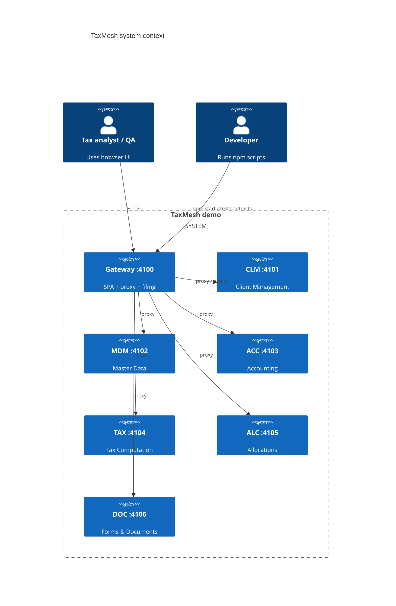
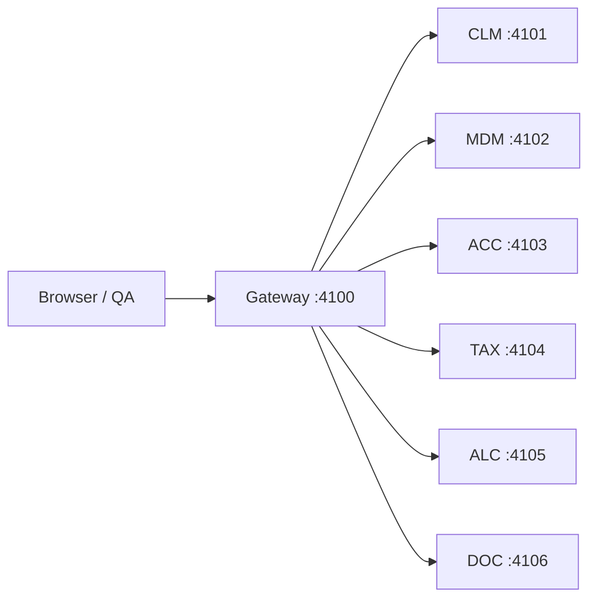
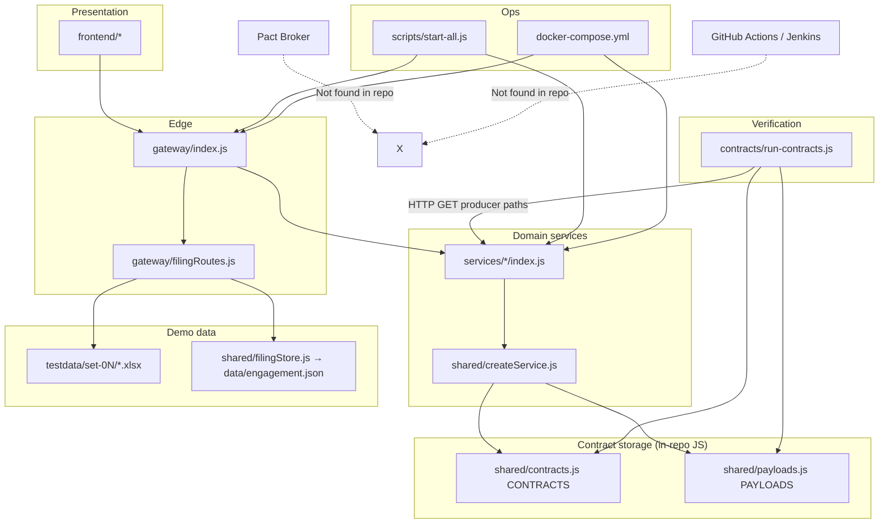
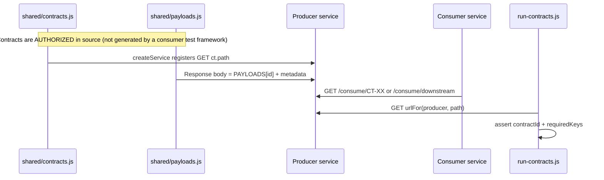
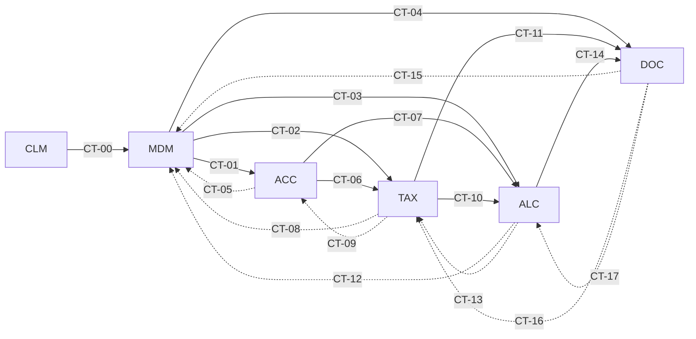
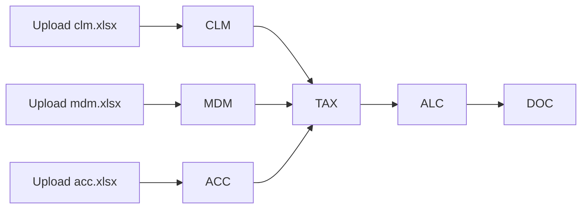
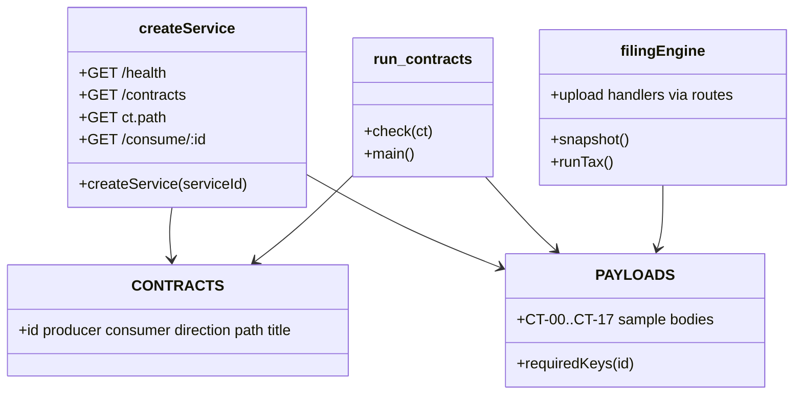

# 02 — Architecture

> Every box maps to a real folder/file under `contract-testing-business-demo/`.

---

## 1. System context (C4-style)

| Box | Real path |
|-----|-----------|
| Gateway | `gateway/index.js`, `gateway/filingRoutes.js` |
| CLM | `services/cem/index.js` → `createService('CLM')` |
| MDM | `services/mad/index.js` → `createService('MDM')` |
| ACC | `services/cam/index.js` → `createService('ACC')` |
| TAX | `services/tim/index.js` → `createService('TAX')` |
| ALC | `services/rpam/index.js` → `createService('ALC')` |
| DOC | `services/forms-print/index.js` → `createService('DOC')` |
| SPA | `frontend/index.html`, `frontend/app.js`, `frontend/styles.css` |
| Shared catalog | `shared/contracts.js`, `shared/payloads.js` |
| Contract runner | `contracts/run-contracts.js` |

Simpler flowchart (same as `docs/ARCHITECTURE.md`):

---

## 2. Component diagram

| Component | Technology | Folder/File |
|-----------|------------|-------------|
| Consumers / Producers | Express microservices | `services/` + `shared/createService.js` |
| Contract catalog | JS arrays/objects | `shared/contracts.js` |
| Sample payloads | JS objects | `shared/payloads.js` |
| Contract storage | **In source code** (not broker) | same files |
| Broker | **Not found** | — |
| CI gate | **Not found** | — |
| Verification runner | Node `fetch` script | `contracts/run-contracts.js` |

---

## 3. Tech stack table

| Layer | Technology | Version | Purpose | Evidence |
|-------|------------|---------|---------|----------|
| Runtime | Node.js | **20** (Docker); local version Not found pinned in README | Run services | `Dockerfile` `FROM node:20-alpine` |
| Package manager | npm | lockfile present | Install deps | `package-lock.json` |
| HTTP API | Express | ^4.21.2 | Microservices + gateway | `package.json` |
| CORS | cors | ^2.8.5 | Cross-origin | `package.json` |
| Uploads | multer | ^2.5.0 | Excel upload | `gateway/filingRoutes.js` |
| Excel | xlsx | ^0.18.5 | Parse/generate sheets | `shared/excelImport.js` |
| OpenAPI UI | swagger-ui-express | ^5.0.1 | Swagger at `/api-docs` | `gateway/index.js` |
| ZIP | archiver | ^5.3.2 | Postman/testdata zips | `gateway/index.js` |
| DOCX gen | docx | ^9.14.0 | Guide generation | `scripts/generate-guide-docx.js` |
| Frontend | Vanilla HTML/CSS/JS | — | SPA | `frontend/` |
| Containers | Docker Compose | compose file v-style | Multi-service | `docker-compose.yml` |
| Contract tool | Custom runner | 1.0.0 app | Shape checks | `contracts/run-contracts.js` |

---

## 4. Dependency table (module → depends on → why)

| Module | Depends on | Why | Evidence |
|--------|------------|-----|----------|
| `services/*/index.js` | `shared/createService.js` | Build Express app | each service file |
| `shared/createService.js` | `contracts.js`, `payloads.js`, `flowApis.js`, `serviceUploads.js`, `serviceValidation.js`, `serviceV2Apis.js` | Routes + payloads | requires at top |
| `shared/flowApis.js` | `contracts.js`, `payloads.js` | Downstream/upstream APIs | requires |
| `contracts/run-contracts.js` | `shared/contracts.js`, `shared/payloads.js` | Verify shapes | requires |
| `gateway/index.js` | `contracts.js`, `payloads.js`, `openapi.js`, `filingRoutes.js`, `flowApis.js` | Proxy + docs + UI | requires |
| `gateway/filingRoutes.js` | `filingEngine.js`, `filingStore.js`, `contracts.js` | Filing orchestration | requires |
| `shared/filingEngine.js` | `filingStore.js`, `payloads.js`, `excelImport.js`, `dataFlow.js`, `businessValidation.js` | Form 1065 journey | requires |
| `frontend/app.js` | Gateway HTTP APIs | UI calls `/api/*` | fetch usage in file |
| `scripts/start-all.js` | child processes of services + gateway | Boot everything | spawn list |
| Docker services | same Node images | Isolated ports | `docker-compose.yml` |

---

## 5. Data / contract flow

| Step | Where | File |
|------|-------|------|
| Contract **defined** | JS catalog | `shared/contracts.js` `CONTRACTS` |
| Shape **defined** | Sample payloads | `shared/payloads.js` `PAYLOADS` |
| Contract **“generated”** | Not generated at runtime from consumer tests — **hand-authored** | Not found: Pact generate step |
| Stored | In git as JS | same files |
| Served | Producer HTTP | `createService.js` `app.get(ct.path, …)` |
| Verified | Runner | `contracts/run-contracts.js` `check` |
| Published to broker | **Not found** | — |

### Contract mesh (downstream solid / upstream dashed)

Evidence: rows in `shared/contracts.js` lines ~96–122; diagram also in `docs/ARCHITECTURE.md`.

### Upload-driven filing flow (separate from CT runner)

Evidence: `shared/dataFlow.js` header comments; `README.md` “Data flow”.

---

## 6. Class / module diagram (logical)

---

## Gate 3

| Check | Status |
|-------|--------|
| Every diagram box → real folder/file | Done |
| Broker / CI | Marked Not found |
| Contract storage = in-repo JS | Confirmed |
| Uncertain | Exact local Node version outside Docker (README does not pin) |
