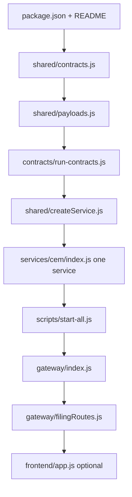

# 03 — File-by-File Guide

> Priority: **Must understand** first. Paths relative to `contract-testing-business-demo/`.

---

## Priority legend

| Tag | Meaning |
|-----|---------|
| **Must understand** | Core to contract testing + architecture |
| **Should know** | Filing demo / ops |
| **Can ignore at first** | Generators, patches, binaries, Word/PDF case studies |

---

## 1. Master inventory table

### Root / config

| File Path | Type | What it does | Key classes/methods/config | Who uses it | Related files | Priority |
|-----------|------|--------------|----------------------------|-------------|---------------|----------|
| `package.json` | npm config | Scripts + deps | `start`, `test:contracts`, `docker:*` | Humans, Docker | `package-lock.json` | **Must** |
| `package-lock.json` | lockfile | Pins dependency versions | npm lock | `npm install` | `package.json` | Can ignore at first |
| `README.md` | docs | Quick start, ports, v2 notes | URLs, commands | Humans | `docs/*` | **Must** |
| `CASE_STUDY.md` | docs | Business case brief | Journey table | Humans | case study PDFs | Should know |
| `.gitignore` | git | Ignores `node_modules`, `data/`, `.env` | patterns | git | — | Can ignore at first |
| `Dockerfile` | Docker | Image: Node 20, `npm start` | `EXPOSE 4100-4106` | `docker compose` | `docker-compose.yml` | Should know |
| `docker-compose.yml` | Docker | 6 services + gateway | `cem`…`forms-print`, `gateway` | Ops | `Dockerfile` | Should know |
| `cloudflared.exe` | binary | Tunnel helper (Windows) | — | Optional public URL | README `PUBLIC_BASE_URL` | Can ignore at first |
| `*.docx` / `*.pdf` (root) | case study assets | Source case studies | — | Reading | `CASE_STUDY.md` | Can ignore at first |

### Contracts

| File Path | Type | What it does | Key symbols | Who uses it | Related | Priority |
|-----------|------|--------------|-------------|-------------|---------|----------|
| `contracts/run-contracts.js` | test runner | Verifies all CT payloads over HTTP | `check`, `main` | `npm run test:contracts` | `shared/contracts.js`, `shared/payloads.js` | **Must** |
| `shared/contracts.js` | catalog | Services, CT-00…17, URL helpers | `SERVICES`, `CONTRACTS`, `urlFor`, `flowSummary` | Almost everything | `payloads.js` | **Must** |
| `shared/payloads.js` | contract shapes | Sample JSON + `requiredKeys` | `PAYLOADS`, `requiredKeys` | producers + runner | `contracts.js` | **Must** |

### Shared runtime

| File Path | Type | What it does | Key symbols | Who uses it | Related | Priority |
|-----------|------|--------------|-------------|-------------|---------|----------|
| `shared/createService.js` | factory | Builds each microservice Express app | `createService` | all `services/*/index.js` | flowApis, uploads, v2 | **Must** |
| `shared/flowApis.js` | routes | Downstream/upstream APIs | `attachFlowApis`, `attachPipeline`, `produceEnvelope` | createService, gateway | contracts.js | **Must** |
| `shared/openapi.js` | OpenAPI builder | Builds Swagger document | `buildOpenApi` | gateway, `generate:openapi` | contracts | Should know |
| `shared/serviceV2Apis.js` | routes | CLM/MDM `/v2/*` | `attachV2Apis`, `attachClmV2` | createService | filingStore | Should know |
| `shared/serviceUploads.js` | routes | Per-service Excel upload | `attachExcelUpload` | CLM/MDM/ACC | excelImport | Should know |
| `shared/serviceValidation.js` | routes | TAX/ALC validate/calc | `attachBusinessValidationApis` | TAX/ALC | businessValidation | Should know |
| `shared/excelImport.js` | parser | Parse CLM/MDM/ACC xlsx | `parseCem`, `parseMad`, `parseCam` | filingEngine | xlsx | Should know |
| `shared/filingEngine.js` | domain engine | Form 1065 step machine | `snapshot`, `runTax`, uploads | filingRoutes | filingStore, dataFlow | **Must** (for demo) |
| `shared/filingStore.js` | persistence | engagement JSON + steps/gates | `STEPS`, `read`/`write` | filingEngine, v2 | `data/engagement.json` | Should know |
| `shared/dataFlow.js` | graph helpers | Upload readiness + flow nodes | `hasClm`, `buildDataFlow` | filingEngine, UI APIs | — | Should know |
| `shared/businessValidation.js` | rules | TAX/ALC Form 1065 checks | `validateTim`, `validateRpam` | filingEngine, serviceValidation | — | Should know |

### Gateway / frontend

| File Path | Type | What it does | Key symbols | Who uses it | Related | Priority |
|-----------|------|--------------|-------------|-------------|---------|----------|
| `gateway/index.js` | Express app | Proxy, Swagger, health, static UI | `/api/health`, `/api/flow`, `/api/proxy` | `npm start` | filingRoutes | **Must** |
| `gateway/filingRoutes.js` | router | `/api/filing/*` uploads & calc | `createFilingRouter` | gateway | filingEngine | **Must** |
| `frontend/index.html` | UI shell | Layout / nav | — | browser | app.js | Should know |
| `frontend/app.js` | UI logic | Module views, uploads, status | `MODULES`, `showView` | browser | gateway APIs | Should know |
| `frontend/styles.css` | styles | Soft teal theme | CSS | index.html | — | Can ignore at first |

### Services (entry points)

| File Path | Type | What it does | Key | Who uses it | Related | Priority |
|-----------|------|--------------|-----|-------------|---------|----------|
| `services/cem/index.js` | entry | Starts **CLM** on 4101 | `createService('CLM')` | start-all, docker | createService | **Must** |
| `services/mad/index.js` | entry | Starts **MDM** on 4102 | `createService('MDM')` | start-all, docker | — | **Must** |
| `services/cam/index.js` | entry | Starts **ACC** on 4103 | `createService('ACC')` | start-all, docker | — | **Must** |
| `services/tim/index.js` | entry | Starts **TAX** on 4104 | `createService('TAX')` | start-all, docker | — | **Must** |
| `services/rpam/index.js` | entry | Starts **ALC** on 4105 | `createService('ALC')` | start-all, docker | — | **Must** |
| `services/forms-print/index.js` | entry | Starts **DOC** on 4106 | `createService('DOC')` | start-all, docker | — | **Must** |
| `services/accounting/index.js` | alias entry | Also ACC | `createService('ACC')` | optional | cam | Can ignore at first |
| `services/master-data/index.js` | alias entry | Also MDM | `createService('MDM')` | optional | mad | Can ignore at first |
| `services/tax-engine/index.js` | alias entry | Also TAX | `createService('TAX')` | optional | tim | Can ignore at first |
| `services/allocations/index.js` | alias entry | Also ALC | `createService('ALC')` | optional | rpam | Can ignore at first |

### Scripts

| File Path | Type | What it does | Key | Who uses it | Related | Priority |
|-----------|------|--------------|-----|-------------|---------|----------|
| `scripts/start-all.js` | launcher | Spawns 6 services + gateway | `procs` array | `npm start` | services/* | **Must** |
| `scripts/generate-excel-datasets.js` | generator | Builds testdata xlsx | — | `npm run generate:excel` | testdata | Can ignore at first |
| `scripts/generate-postman.js` | generator | Postman JSON | — | `generate:postman` | postman/ | Can ignore at first |
| `scripts/generate-guide-docx.js` | generator | Word guide | — | `generate:guide` | docs | Can ignore at first |
| `scripts/extract-docx.js` | util | Extract docx text | — | maintainers | — | Can ignore at first |
| `scripts/patch-*.js` | one-off patches | Historical code patches | — | maintainers | — | Can ignore at first |
| `scripts/rewrite-authors.js` / `strip-coauthors.sh` | git helpers | Author rewrite | — | maintainers | — | Can ignore at first |

### Testdata / Postman / Docs

| File Path | Type | What it does | Key | Who uses it | Related | Priority |
|-----------|------|--------------|-----|-------------|---------|----------|
| `testdata/index.json` | catalog | Lists set-01…05 | `datasets` | UI / gateway | xlsx files | Should know |
| `testdata/set-0N/{clm,mdm,acc}.xlsx` | demo data | Upload inputs | Excel sheets | filing upload | excelImport | Should know |
| `postman/TaxMesh.postman_*.json` | Postman | API collection | — | Postman app | generate-postman | Can ignore at first |
| `docs/ARCHITECTURE.md` | docs | Arch overview | mermaid | humans | this analysis | Should know |
| `docs/API.md` | docs | API reference | tables | humans | openapi | Should know |
| `docs/APPLICATION_MANUAL.md` | docs | Install/UI walkthrough | — | humans | README | Can ignore at first |
| `docs/openapi.json` | OpenAPI | Static export | — | Swagger consumers | openapi.js | Can ignore at first |
| `docs/TaxMesh_API_Architecture_and_Developer_Guide.md` | long guide | Full developer guide | — | humans | — | Can ignore at first |

---

## 2. Deep dive — 8 most important files (block by block)

### A. `shared/contracts.js` — **Must understand**

| Block | What it does | Why it exists |
|-------|--------------|---------------|
| Header comment | Names 6 services + aliases | Orients readers to CLM…DOC |
| `SERVICES` object | id, name, port, role, out/in counts | Single source of truth for ports |
| `SERVICE_ALIASES` | CEM→CLM, A→MDM, etc. | Backward compatibility |
| `resolveServiceId` | Normalize any alias to current id | Safe lookups |
| `CONTRACTS` array | CT-00…CT-17 rows | **The contract catalog** |
| `urlFor` | Build `http://127.0.0.1:port` + path (or env `URL_*`) | Runner + consume calls |
| `contractsProducedBy` / `ConsumedBy` | Filter catalog | Wire routes per service |
| `normalizeDirection` / `apiDirection` | reverse ≡ upstream | API naming |
| `flowSummary` / `allFlowEdges` | Graph for `/api/flow` | Visualization |
| `module.exports` | Public API | Imported everywhere |

### B. `shared/payloads.js` — **Must understand**

| Block | What it does | Why |
|-------|--------------|-----|
| `engagementId` / `entityId` constants | Shared demo IDs | Consistent samples |
| `PAYLOADS['CT-00']` … `['CT-17']` | Exact JSON fields | **This IS the contract shape** |
| `requiredKeys(contractId)` | All keys except `contractId` | Runner assertions |
| exports | Used by producers + tests | Shared truth |

### C. `contracts/run-contracts.js` — **Must understand**

| Block | What it does | Why |
|-------|--------------|-----|
| requires | Load catalog + payloads | Need expected shapes |
| `check(ct)` | `fetch` producer → assert HTTP ok, `contractId`, each required key, PAYLOADS exists | Lightweight provider verification |
| `main()` | Loop all CONTRACTS, log PASS/FAIL, `process.exit(1)` if any fail | CLI test entry |
| catch on main | Unexpected errors → exit 1 | Fail hard |

### D. `shared/createService.js` — **Must understand**

| Block | What it does | Why |
|-------|--------------|-----|
| Express + cors + json | Standard HTTP service | Each MS is HTTP |
| `/health` | Liveness + produced/consumed lists | Gateway health aggregation |
| `/contracts` | Catalog for this service | Discovery |
| `attachFlowApis` | Downstream/upstream routes | Flow APIs |
| Loop `produced` → `GET ct.path` | Return `PAYLOADS` + metadata | **Producer side of contract** |
| `/consume/:contractId` | Pull from producer via `urlFor` | **Consumer side** |
| `attachPipeline` | Reachability of producers | Diagnostics |
| Conditional uploads / validation / v2 | Feature flags by service id | CLM/MDM/ACC/TAX/ALC specifics |

### E. `scripts/start-all.js` — **Must understand**

| Block | What it does | Why |
|-------|--------------|-----|
| `procs` list | Maps label → legacy folder script | Boot order of 7 processes |
| `spawn` loop | Child Node processes, inherit stdio | One command starts mesh |
| `shutdown` on SIGINT/TERM | Kill children | Clean stop |

### F. `gateway/index.js` — **Must understand**

| Block | What it does | Why |
|-------|--------------|-----|
| Express setup + trust proxy | Tunnel-friendly | Cloudflare |
| `/api/filing` router | Filing journey | Demo business flow |
| OpenAPI + Swagger | Interactive docs | Teaching / try APIs |
| Static `/docs`, downloads | Serve guides/postman/testdata | Convenience |
| `/api/health` | Probe all 6 services | Ops dashboard |
| `/api/architecture`, `/api/contracts`, `/api/flow` | Mesh metadata | Teaching APIs |
| Proxy routes (later in file) | Forward to microservices | SPA single origin |
| Static frontend | Serve SPA | UI |

### G. `gateway/filingRoutes.js` — **Should know / Must for demo**

| Block | What it does | Why |
|-------|--------------|-----|
| multer memory storage | Accept `.xlsx` ≤5MB | Upload safety |
| GET `/` snapshot | Current engagement state | UI refresh |
| reset / run / run-all / process-flow | Drive steps | Demo orchestration |
| validate tax/alc + calculate/allocate | Business gates | AQG-style checks |
| upload clm/mdm/acc | Import Excel into store | Real demo path |

### H. `shared/filingEngine.js` — **Should know**

| Block | What it does | Why |
|-------|--------------|-----|
| `snapshot` | Full UI state + dataFlow | Single response for SPA |
| `isStepDone` | Step completion rules | Progress UI |
| jobs / quality gates | Async + AQG1–5 | Case study alignment |
| tax/allocate/forms/efile logic | Compute Form 1065 outputs | Business demo (beyond pure CT) |

---

## 3. Quick “read order” for beginners

---

## Gate 4

| Check | Status |
|-------|--------|
| Important files tabulated | Done |
| 8 deep dives | Done |
| Generators/patches marked ignorable | Done |
| Uncertain | Full line-by-line of entire `filingEngine.js` (~900+ lines) summarized by responsibility, not every helper |
