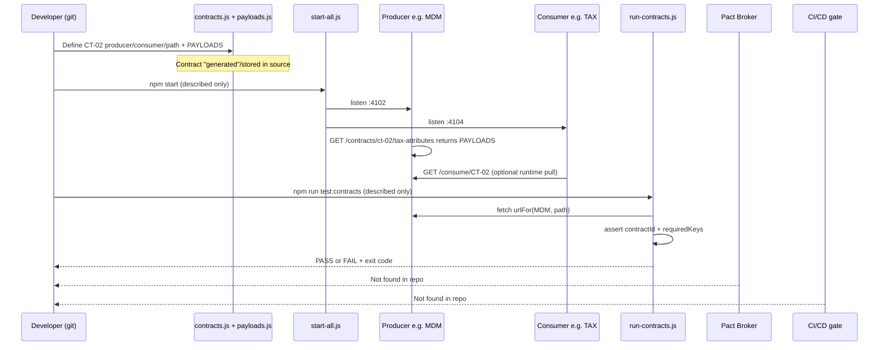
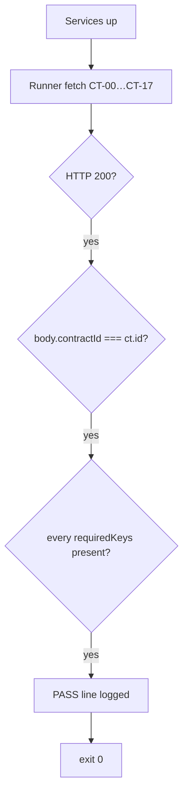
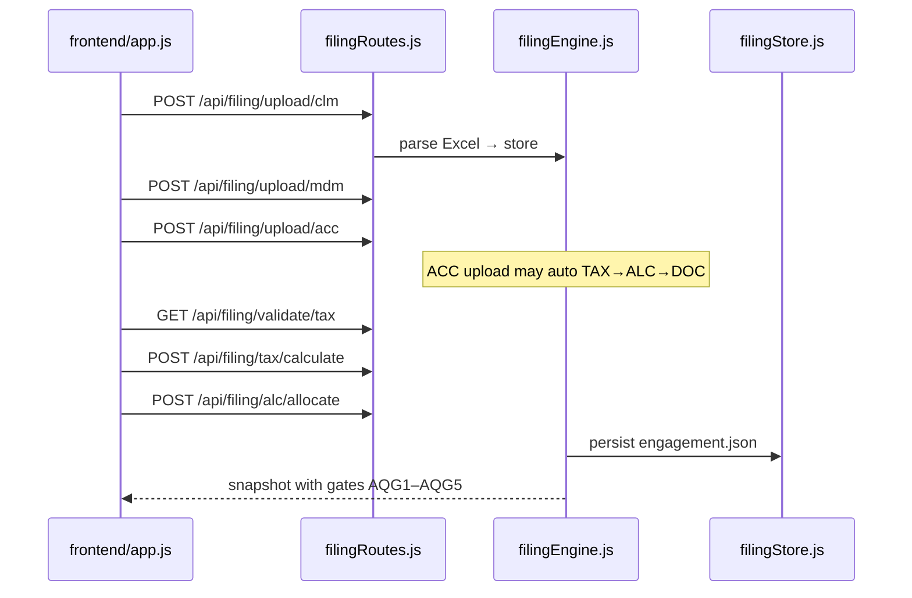

# 04 — End-to-End Flow

> Theoretical walkthrough only. **No tests were executed** for this analysis.

---

## 1. Lifecycle sequence (how contracts work HERE)

**Important difference from classic Pact:** In this repo, contracts are **hand-authored in JS**, not generated by a consumer unit test framework. The “consumer test” step is replaced by **catalog + sample payloads**. Verification = HTTP GET against live producers.



---

## 2. Numbered lifecycle table

| Step | Actor | Action | File / Class / Method | Output |
|------|-------|--------|----------------------|--------|
| 1 | Developer | Author CT metadata | `CONTRACTS` in `shared/contracts.js` | Catalog row (id, producer, consumer, path, direction) |
| 2 | Developer | Author JSON shape | `PAYLOADS` in `shared/payloads.js` | Sample body keys |
| 3 | Service factory | Register produce route | `createService` loop `app.get(ct.path, …)` | Live endpoint |
| 4 | Ops / QA | Start mesh | `scripts/start-all.js` → `npm start` | Processes on 4100–4106 |
| 5 | Consumer (runtime) | Optional pull | `GET /consume/:contractId` in `createService.js` | `{ payload, ok, sourceUrl }` |
| 6 | Contract runner | Verify all CTs | `check(ct)` in `contracts/run-contracts.js` | Console `PASS` / `FAIL` |
| 7 | Runner | Aggregate | `main()` | `N/18 contracts passed`; exit 1 if fail |
| 8 | Broker publish | — | **Not found in repo** | — |
| 9 | CI can-i-deploy | — | **Not found in repo** | — |

---

## 3. Happy path (contracts stay valid)



| Assertion in `check(ct)` | Source |
|--------------------------|--------|
| `res.ok` | HTTP status from producer |
| `body.contractId === ct.id` | Response must echo catalog id |
| `key in body` for each `requiredKeys(ct.id)` | Keys from `PAYLOADS` minus `contractId` |
| `PAYLOADS[ct.id]` exists | Catalog/payloads stay in sync |

Expected console shape (**expected behaviour, not captured output**):

```text
PASS  CT-00  CLM→MDM  (downstream)
PASS  CT-01  MDM→ACC  (downstream)
…
18/18 contracts passed
```

---

## 4. Contract broken path (theoretical)

**Scenario:** Provider MDM changes CT-02 response and **removes** field `taxAttributes` (or stops returning `contractId: 'CT-02'`).

```mermaid
flowchart TD
  A[Developer edits createService response or PAYLOADS inconsistently] --> B[MDM still up]
  B --> C[run-contracts check CT-02]
  C --> D{contractId match?}
  D -->|no| F1[FAIL: Expected contractId CT-02, got …]
  D -->|yes| E{taxAttributes in body?}
  E -->|no| F2[FAIL: CT-02 missing key "taxAttributes"]
  F1 --> X[failed++ ; exit 1]
  F2 --> X
```

| If change is… | Which check fails | Why (code) |
|---------------|-------------------|------------|
| Producer down / wrong port | `HTTP ${status}` or fetch throw | `check` first lines |
| Wrong `contractId` in JSON | `Expected contractId…` | `body.contractId !== ct.id` |
| Missing field still listed in `PAYLOADS` | `missing key "…"` | `requiredKeys` loop |
| Delete sample from `PAYLOADS` but leave `CONTRACTS` | `No sample payload for CT-xx` | last assert in `check` |
| Change only consumer code | Runner may still **PASS** | Runner does **not** execute consumer business logic — only producer shape |

**Filing demo impact (separate from runner):** If Excel/MDM data lacks partners/EIN, `validateTim` in `shared/businessValidation.js` adds findings like `TIM-BV-02` — UI/API returns 422 on tax calculate (`gateway/filingRoutes.js`), even if CT runner still passes sample payloads.

---

## 5. Sample contract explained — CT-02

**Catalog row** (`shared/contracts.js`):

| Field | Value | Meaning |
|-------|-------|---------|
| `id` | `CT-02` | Contract identifier |
| `producer` | `MDM` | Who serves JSON |
| `consumer` | `TAX` | Who needs it |
| `direction` | `downstream` | Forward along journey |
| `path` | `/contracts/ct-02/tax-attributes` | HTTP path on MDM |
| `title` | `Entity tax attributes` | Human label |

**Sample payload** (`shared/payloads.js` → `PAYLOADS['CT-02']`):

| Field | Example value | Meaning |
|-------|---------------|---------|
| `contractId` | `CT-02` | Must match catalog; asserted by runner |
| `engagementId` | `ENG-2025-1065-001` | Ties data to engagement |
| `entityId` | `ENT-ALPHA-LP` | Partnership entity |
| `taxAttributes` | object | Tax setup block |
| `taxAttributes.filingType` | `1065` | Form type |
| `taxAttributes.fiscalYearEnd` | `12-31` | FYE |
| `taxAttributes.multiState` | `true` | Multi-state flag |
| `taxAttributes.states` | `['NY','CA']` | State list |
| `taxAttributes.section754Election` | `true` | 754 election |

**Extra fields added at produce time** (`createService.js`):

| Field | Meaning |
|-------|---------|
| `producer` | Service id |
| `consumer` | Target consumer |
| `direction` / `flow` | downstream vs upstream |
| `producedAt` | ISO timestamp |

**Required keys for runner** = `engagementId`, `entityId`, `taxAttributes` (via `requiredKeys` — all keys except `contractId`).

---

## 6. Full contract matrix (evidence)

| ID | Producer → Consumer | Direction | Path |
|----|---------------------|-----------|------|
| CT-00 | CLM → MDM | downstream | `/contracts/ct-00/engagement-context` |
| CT-01 | MDM → ACC | downstream | `/contracts/ct-01/entities` |
| CT-02 | MDM → TAX | downstream | `/contracts/ct-02/tax-attributes` |
| CT-03 | MDM → ALC | downstream | `/contracts/ct-03/ownership` |
| CT-04 | MDM → DOC | downstream | `/contracts/ct-04/filing-meta` |
| CT-05 | ACC → MDM | reverse | `/contracts/ct-05/mapping-gaps` |
| CT-06 | ACC → TAX | downstream | `/contracts/ct-06/book-balances` |
| CT-07 | ACC → ALC | downstream | `/contracts/ct-07/capital-map` |
| CT-08 | TAX → MDM | reverse | `/contracts/ct-08/attribute-gaps` |
| CT-09 | TAX → ACC | reverse | `/contracts/ct-09/btt-asks` |
| CT-10 | TAX → ALC | downstream | `/contracts/ct-10/taxable-income` |
| CT-11 | TAX → DOC | downstream | `/contracts/ct-11/tax-summary` |
| CT-12 | ALC → MDM | reverse | `/contracts/ct-12/ownership-issues` |
| CT-13 | ALC → TAX | reverse | `/contracts/ct-13/allocation-needs` |
| CT-14 | ALC → DOC | downstream | `/contracts/ct-14/partner-allocations` |
| CT-15 | DOC → MDM | reverse | `/contracts/ct-15/entity-print-needs` |
| CT-16 | DOC → TAX | reverse | `/contracts/ct-16/tax-line-needs` |
| CT-17 | DOC → ALC | reverse | `/contracts/ct-17/capital-restatement` |

Source: `shared/contracts.js` `CONTRACTS` array.

---

## 7. Filing happy path (business demo, not the CT runner)



---

## Gate 5

| Check | Status |
|-------|--------|
| Flows match actual test names (`check`, `main`, CT ids) | Done |
| Happy + broken paths from code | Done |
| Sample CT-02 field table | Done |
| Broker/CI steps | Not found — shown as such |
| Uncertain | Exact console formatting if Node version differs — based on `console.log` template strings only |
