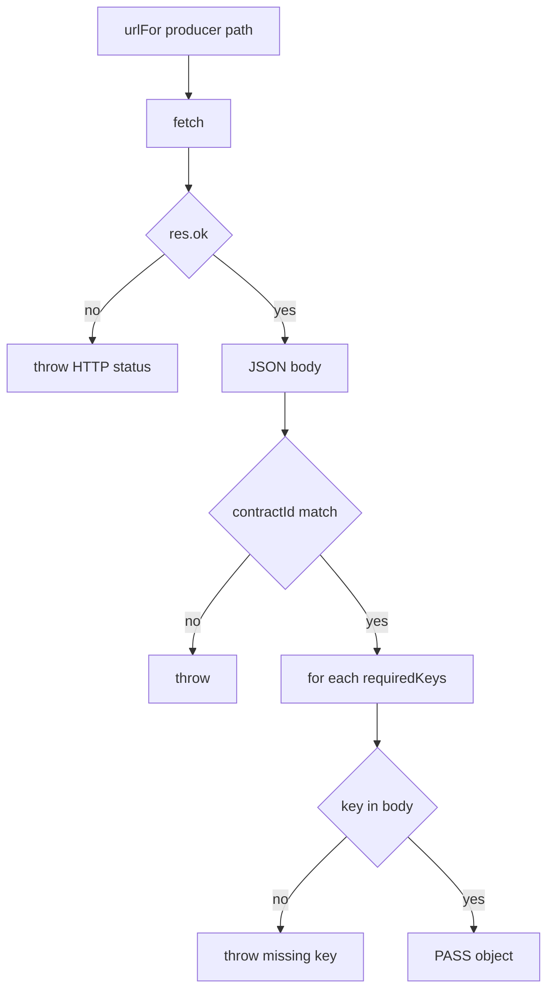

# 05 — How It Runs (Explained Only — NOT Executed)

> Every command row is marked **Not executed - explained only**. Analysis is from README + `package.json` + source.

---

## 1. Prerequisites

| Tool / item | Version found | Required for | Evidence |
|-------------|---------------|--------------|----------|
| Node.js | **20** in Docker image; local exact version **Not found** in README | Run app & scripts | `Dockerfile` `FROM node:20-alpine` |
| npm | Comes with Node; lockfile present | `npm install`, scripts | `package-lock.json` |
| Docker + Compose | Compose file present | Optional container run | `docker-compose.yml` |
| Git | Repo has `.git` | Clone only | folder `.git` |
| Pact CLI / Broker | **Not found** | — | — |
| Java / Maven / Gradle | **Not found** | — | — |
| Browser | Any modern | UI at :4100 | `README.md` |
| Optional `PUBLIC_BASE_URL` | env var | Tunnel/Swagger absolute host | `README.md`, `gateway/index.js` |

Install step described in README (not run here):

```bash
npm install
```

---

## 2. Commands table

| Command | What it does internally | What it produces | Where output appears | Status |
|---------|------------------------|------------------|----------------------|--------|
| `npm install` | Reads `package.json` / lockfile; installs Express, multer, xlsx, etc. | `node_modules/` | Console + folder | **Not executed - explained only** |
| `npm start` | Runs `node scripts/start-all.js` → spawns 6 services + gateway | 7 Node processes | Console logs per service; ports 4100–4106 | **Not executed - explained only** |
| `npm run start:clm` (etc.) | Starts one service entry | One listener | Console `[CLM] …` | **Not executed - explained only** |
| `npm run start:gateway` | `node gateway/index.js` | Gateway only | :4100 | **Not executed - explained only** |
| `npm run test:contracts` | `node contracts/run-contracts.js` → `check` each CT | PASS/FAIL lines; exit 0/1 | stdout | **Not executed - explained only** |
| `npm run generate:excel` | `scripts/generate-excel-datasets.js` | `testdata/set-0N/{clm,mdm,acc}.xlsx` | filesystem | **Not executed - explained only** |
| `npm run generate:openapi` | Inline node write of `buildOpenApi()` | `docs/openapi.json` | filesystem + console | **Not executed - explained only** |
| `npm run generate:postman` | `scripts/generate-postman.js` | Postman JSON files | `postman/` | **Not executed - explained only** |
| `npm run generate:guide` | `scripts/generate-guide-docx.js` | Word guide | `docs/*.docx` | **Not executed - explained only** |
| `npm run docker:up` | `docker compose up --build` | Containers for cem…gateway | Docker + mapped ports | **Not executed - explained only** |
| `npm run docker:down` | `docker compose down` | Stops containers | Docker | **Not executed - explained only** |

### What `npm start` boots (`scripts/start-all.js`)

| Label | Script path | Port (from `SERVICES`) |
|-------|-------------|------------------------|
| CLM | `services/cem/index.js` | 4101 |
| MDM | `services/mad/index.js` | 4102 |
| ACC | `services/cam/index.js` | 4103 |
| TAX | `services/tim/index.js` | 4104 |
| ALC | `services/rpam/index.js` | 4105 |
| DOC | `services/forms-print/index.js` | 4106 |
| Gateway | `gateway/index.js` | 4100 |

### What `test:contracts` does inside `check(ct)`



---

## 3. Expected PASS vs FAIL (not real output)

### PASS — expected behaviour

| Signal | Meaning | Code |
|--------|---------|------|
| Line `PASS  CT-xx  PROD→CONS  (direction)` | That contract’s producer responded with correct id + keys | `console.log` in `main` |
| Final `18/18 contracts passed` | All `CONTRACTS.length` ok | end of `main` |
| Process exit code **0** | `failed === 0` | no `process.exit(1)` |

### FAIL — expected behaviour

| Signal | Meaning | Code |
|--------|---------|------|
| `FAIL  CT-xx  …  HTTP 404 from …` | Producer route missing / service down | thrown Error |
| `FAIL  … Expected contractId CT-02, got …` | Wrong id in body | assert |
| `FAIL  … CT-02 missing key "taxAttributes"` | Shape drift | `requiredKeys` loop |
| Final `k/18 contracts passed` with k&lt;18 | Partial success | filter PASS count |
| Exit code **1** | Any failure | `if (failed) process.exit(1)` |

### Filing API FAIL (separate)

| Signal | Meaning | Evidence |
|--------|---------|----------|
| HTTP **422** on `/api/filing/validate/tax` | Business validation failed | `filingRoutes.js` + `validateTim` |
| Finding codes `TIM-BV-01`… | Missing engagement/entity/TB | `businessValidation.js` |

---

## 4. Useful URLs (when running — described from README)

| URL | Resource |
|-----|----------|
| http://127.0.0.1:4100 | TaxMesh UI |
| http://127.0.0.1:4100/api-docs | Swagger |
| http://127.0.0.1:4100/openapi.json | OpenAPI JSON |
| http://127.0.0.1:4100/api/flow | Downstream + upstream catalog |
| http://127.0.0.1:4100/download/postman.zip | Postman ZIP |

---

## 5. Troubleshooting

| Problem | Likely cause | Fix (from repo config) |
|---------|--------------|------------------------|
| `test:contracts` all FAIL / fetch errors | Services not started | Run `npm start` first (README order) |
| One service unhealthy in `/api/health` | Process crashed / port busy | Check console from `start-all.js`; free ports 4101–4106 |
| Docker services can’t reach each other | Need compose DNS names | Env `URL_CEM`… in `docker-compose.yml` `x-env` |
| Upload rejected | Not `.xlsx` or &gt;5MB | `multer` filter/limits in `filingRoutes.js` |
| Swagger wrong host behind tunnel | Absolute localhost in older setups | Set `PUBLIC_BASE_URL` or use same-origin `/` (`README.md`, gateway) |
| Postman download 404 | Files not generated | `npm run generate:postman` (README) |
| Guide docx 404 | Not generated | `npm run generate:guide` |
| Ownership / tax validation errors | Bad Excel data | Use `testdata/set-0N`; ownership must total 100% (`docs/API.md`) |
| Legacy path confusion | CEM vs CLM | Aliases in `SERVICE_ALIASES` — both work |
| Looking for Pact broker | Tool not used | Use custom runner only |

---

## 6. Docker layout (explained)

| Compose service | Command | Host port | Maps to workspace |
|-----------------|---------|-----------|-------------------|
| `cem` | `node services/cem/index.js` | 4101 | CLM |
| `mad` | `node services/mad/index.js` | 4102 | MDM |
| `cam` | `node services/cam/index.js` | 4103 | ACC |
| `tim` | `node services/tim/index.js` | 4104 | TAX |
| `rpam` | `node services/rpam/index.js` | 4105 | ALC |
| `forms-print` | `node services/forms-print/index.js` | 4106 | DOC |
| `gateway` | `node gateway/index.js` | 4100 | UI + proxy |

Evidence: `docker-compose.yml`.

---

## Gate 6

| Check | Status |
|-------|--------|
| Commands from README/`package.json` only | Done |
| Nothing executed | Confirmed (explain-only) |
| PASS/FAIL labelled expected behaviour | Done |
| Uncertain | Whether `fetch` is available on very old Node without Docker — Docker pins 20; README silent on minimum local Node |
