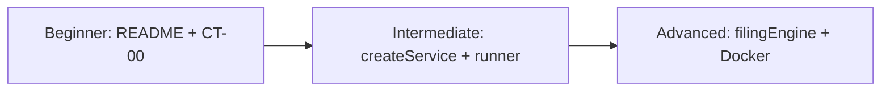

# 06 — Glossary + Q&A

---

## 1. Glossary

| Term | Simple meaning | Where in THIS repo |
|------|----------------|--------------------|
| **TaxMesh** | Name of this Form 1065 microservices demo | `README.md`, `package.json` description |
| **Contract** | Agreed JSON shape between producer & consumer | `shared/contracts.js` + `shared/payloads.js` |
| **CT-00 … CT-17** | The 18 named contracts | `CONTRACTS` array |
| **Producer** | Service that exposes the contract HTTP GET | `CONTRACTS[].producer` |
| **Consumer** | Service that needs that data | `CONTRACTS[].consumer` |
| **Downstream** | Forward along CLM→…→DOC | `direction: 'downstream'` |
| **Upstream / reverse** | Feedback ask to an earlier service | `direction: 'reverse'`; API name `upstream` |
| **Payload** | Sample JSON body | `PAYLOADS` |
| **requiredKeys** | Keys the runner requires (except contractId) | `payloads.js` `requiredKeys` |
| **Provider verification** | Checking producer still returns shape | `contracts/run-contracts.js` `check` |
| **Pact** | Popular contract-testing tool | **Not found in repo** |
| **Broker** | Central contract store | **Not found in repo** |
| **can-i-deploy** | Broker deploy safety check | **Not found in repo** |
| **CLM** | Client Management (engagement) | port 4101, `services/cem` |
| **MDM** | Master Data | port 4102, `services/mad` |
| **ACC** | Accounting | port 4103, `services/cam` |
| **TAX** | Tax Computation | port 4104, `services/tim` |
| **ALC** | Allocations | port 4105, `services/rpam` |
| **DOC** | Forms & Documents | port 4106, `services/forms-print` |
| **CEM/MAD/CAM/TIM/RPAM/FORMS** | Legacy aliases for above | `SERVICE_ALIASES` |
| **A/B/C/D/E** | Letter aliases MDM…DOC | `SERVICE_ALIASES` |
| **Gateway** | Front door :4100 | `gateway/index.js` |
| **Filing engine** | Form 1065 step orchestration | `shared/filingEngine.js` |
| **AQG1–AQG5** | Quality gates on filing journey | `docs/ARCHITECTURE.md`, `filingStore` steps |
| **MeF / e-file** | Electronic filing end state | filing status `efiled` |
| **Form 1065** | US partnership tax return | domain of demo |
| **K-1 / K-3** | Partner schedule forms | DOC / ALC payloads |
| **createService** | Factory that builds each MS | `shared/createService.js` |
| **Flow APIs** | `/downstream`, `/upstream`, `/consume/*` | `shared/flowApis.js` |
| **Swagger / OpenAPI** | Interactive API docs | `/api-docs`, `shared/openapi.js` |
| **Excel import** | Upload-driven demo data | `testdata`, `excelImport.js` |
| **Mock/stub (here)** | In-memory `PAYLOADS` returned by producers | `createService` produce routes |
| **Integration test** | Multi-component behaviour | Filing demo (not a separate suite) |
| **E2E** | Full UI journey | Manual via `frontend/` |
| **urlFor** | Builds service base URL + path | `contracts.js` |
| **correlationId** | Ties engagement work together | filing / CLM context |

---

## 2. Interview-style Q&A (15) — answers from THIS project

| # | Question | Short answer |
|---|----------|--------------|
| 1 | What problem does this repo demonstrate? | Keeping API shapes stable across 6 tax microservices (Form 1065) using CT-00…CT-17. |
| 2 | Is this Pact? | No. Custom Node runner in `contracts/run-contracts.js`. |
| 3 | Where is the contract stored? | In source: `shared/contracts.js` + `shared/payloads.js` (no broker). |
| 4 | What does `npm run test:contracts` do? | HTTP GETs each producer path; asserts `contractId` and required keys. |
| 5 | Who is producer for CT-02? | MDM; consumer is TAX (`shared/contracts.js`). |
| 6 | Downstream vs upstream? | Downstream = journey forward; upstream = reverse feedback (`apiDirection`). |
| 7 | How does a service expose a contract? | `createService` registers `GET ct.path` returning `PAYLOADS[ct.id]`. |
| 8 | How does a consumer pull a contract? | `GET /consume/:contractId` fetches producer via `urlFor`. |
| 9 | What happens if a required field is removed? | Runner logs `FAIL … missing key` and exits 1. |
| 10 | What are AQG1–AQG5? | Filing quality gates (CLM→MDM … through MeF), documented in `docs/ARCHITECTURE.md`. |
| 11 | Why Excel uploads? | Drive realistic Form 1065 demo data into the filing engine (`testdata/`). |
| 12 | What does the gateway do? | SPA, Swagger, filing APIs, proxy to services (`gateway/index.js`). |
| 13 | How do you start everything? | `npm start` → `scripts/start-all.js` spawns 7 processes. |
| 14 | Is there CI that blocks deploy? | **Not found in repo** (no workflows / can-i-deploy). |
| 15 | Why legacy folder names like `cem`? | Historical codes; aliases map CEM→CLM; Docker/start still use old folder paths. |

---

## 3. “Explain this project in 2 minutes” script

> TaxMesh is a **Node/Express demo** of a **US partnership Form 1065** pipeline split into **six microservices**: CLM, MDM, ACC, TAX, ALC, and DOC, plus a **gateway UI on port 4100**.  
> Between those services there are **18 contracts, CT-00 through CT-17** — some **downstream** (forward data) and some **upstream/reverse** (feedback asks).  
> Unlike Pact, contracts here are **plain JavaScript objects** in `shared/contracts.js` and `shared/payloads.js`. Each producer serves its sample JSON on a fixed path; `npm run test:contracts` **fetches those URLs** and checks that the **`contractId` and required fields** are still present.  
> Separately, you can **upload Excel** files and walk the **filing journey** with business validation and quality gates — that’s the business demo layered on top of the contract mesh.  
> There is **no Pact broker and no CI can-i-deploy** in this repository; the teaching focus is the **mesh + shape checks + Form 1065 story**.

---

## 4. Learning path

| Level | Topic | Where in repo |
|-------|-------|---------------|
| Beginner | Ports, journey, what CT means | `README.md`, `CASE_STUDY.md`, `docs-analysis/01-beginner-concepts.md` |
| Beginner | Read one contract end-to-end | `CONTRACTS` CT-00 + `PAYLOADS['CT-00']` |
| Beginner | Run story (when you execute later) | `npm start`, UI :4100 |
| Intermediate | Service factory + produce/consume | `shared/createService.js`, `shared/flowApis.js` |
| Intermediate | Contract runner assertions | `contracts/run-contracts.js` |
| Intermediate | Downstream vs upstream catalog | `GET /api/flow` code in `gateway/index.js` |
| Intermediate | Architecture diagrams | `docs/ARCHITECTURE.md`, `docs-analysis/02-architecture.md` |
| Advanced | Filing engine + gates | `shared/filingEngine.js`, `businessValidation.js` |
| Advanced | OpenAPI generation | `shared/openapi.js` |
| Advanced | Docker multi-service env URLs | `docker-compose.yml` `URL_*` |
| Advanced | Compare to real Pact/broker | Contrast with **Not found** pieces; design what you’d add |

---

## 5. Final summary of uncertainties

| Item | Status |
|------|--------|
| Pact / broker / can-i-deploy / CI | Confirmed **Not found** |
| Local Node version (non-Docker) | **Not pinned** in README |
| Alias service folders vs start-all paths | Both exist; start-all uses legacy names |
| Whether `PAYLOADS` nested objects are deeply schema-validated | **No** — runner only checks top-level keys via `requiredKeys` |
| Automated E2E/unit suites | **Not found** |

---

## Gate 7

| Check | Status |
|-------|--------|
| Glossary of terms used | Done |
| 15 interview Q&As mapped to project | Done |
| 2-minute script | Done |
| Learning path | Done |
| Uncertainties listed | Done |
