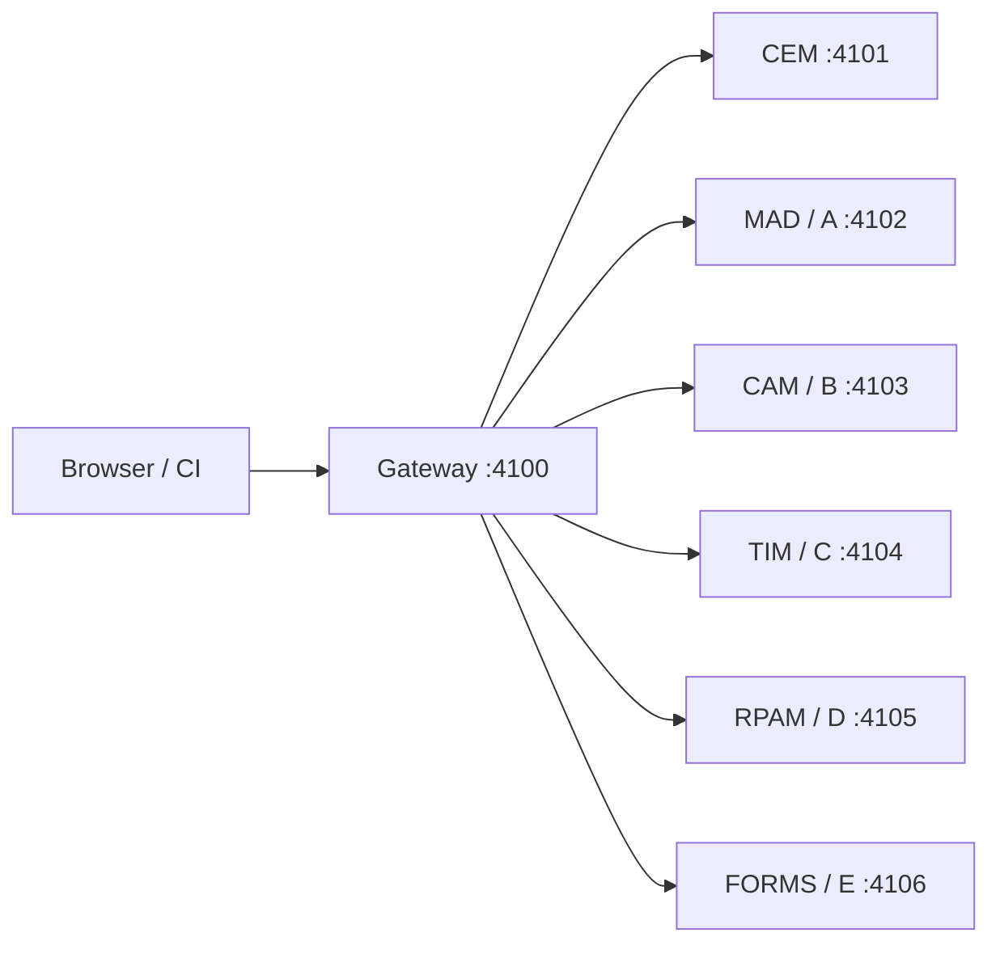
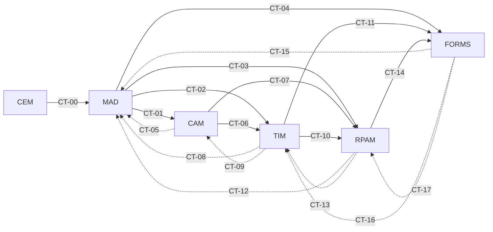
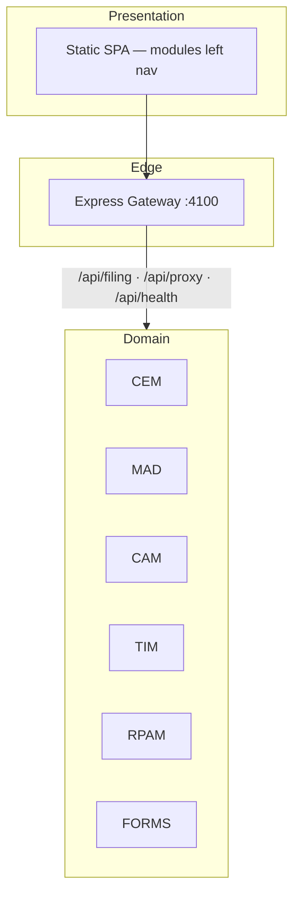

# TaxMesh — Application & Microservice Architecture

**System:** TaxMesh US Partnership Form 1065 demo  
**Pattern:** Six separate microservices — **CEM · MAD · CAM · TIM · RPAM · Forms Print**  
**Guide:** [TaxMesh_API_Architecture_and_Developer_Guide.md](TaxMesh_API_Architecture_and_Developer_Guide.md) · `.docx` in this folder

---

## 1. Platform overview

TaxMesh supports an upload-driven Form **1065** filing journey:

**CEM → MAD → CAM → TIM → RPAM → Forms Print / E-file**

The gateway (`:4100`) hosts the SPA, filing orchestration (`/api/filing/*`), service proxy (`/api/proxy/{CEM|MAD|CAM|TIM|RPAM|FORMS|A|B|C|D|E}/…`), health, architecture, and Swagger.

**Letter aliases (contract guide):** A = MAD · B = CAM · C = TIM · D = RPAM · E = FORMS. CEM has no letter alias.

---

## 2. Domain services

| Service | Letter | Port | Domain role |
|---------|--------|------|-------------|
| **CEM** | — | 4101 | Engagement, project, entity group, job, **entity name** |
| **MAD** | A | 4102 | Legal entity detail, partners, ownership, SALT |
| **CAM** | B | 4103 | Trial balance / chart of accounts |
| **TIM** | C | 4104 | Federal/state tax calculation + business validation |
| **RPAM** | D | 4105 | Partner allocations / K-1 amounts + business validation |
| **Forms Print** | E | 4106 | Form 1065 / K-1 package + MeF |

### Upload-driven data flow

1. **Upload CEM + MAD** → engagement & entity/partners available to **CAM** and **TIM**.  
2. **Upload CAM** → joins CEM + MAD, then feeds **TIM** and **RPAM**.  
3. **TIM + RPAM calculate** (with business validation) → **Forms Print**.

CAM upload automatically runs **TIM → RPAM → Forms Print**.  
**Reset** clears the engagement banner and all upload state (no leftover demo seed).

---

## 3. Contract matrix (CT-00 … CT-17)

| ID | Producer → Consumer | Direction | Purpose |
|----|---------------------|-----------|---------|
| CT-00 | CEM → MAD | Downstream | Engagement / project / job context |
| CT-01 | MAD → CAM | Downstream | Entities for account mapping |
| CT-02 | MAD → TIM | Downstream | Entity tax attributes |
| CT-03 | MAD → RPAM | Downstream | Partner ownership |
| CT-04 | MAD → FORMS | Downstream | Filing metadata |
| CT-05 | CAM → MAD | Reverse | Missing entity / account codes |
| CT-06 | CAM → TIM | Downstream | Book account balances |
| CT-07 | CAM → RPAM | Downstream | Capital account mappings |
| CT-08 | TIM → MAD | Reverse | Tax attribute corrections |
| CT-09 | TIM → CAM | Reverse | Book-to-tax reconciling asks |
| CT-10 | TIM → RPAM | Downstream | Taxable income buckets |
| CT-11 | TIM → FORMS | Downstream | Tax computation summary |
| CT-12 | RPAM → MAD | Reverse | Ownership validation issues |
| CT-13 | RPAM → TIM | Reverse | Adjusted tax amount needs |
| CT-14 | RPAM → FORMS | Downstream | Partner allocation / K-1 |
| CT-15 | FORMS → MAD | Reverse | Legal name / EIN for forms |
| CT-16 | FORMS → TIM | Reverse | Tax line amounts for forms |
| CT-17 | FORMS → RPAM | Reverse | Partner capital restatement |

Solid = downstream · Dashed = reverse.

---

## 4. Runtime architecture

Each domain service exposes:

| Endpoint | Purpose |
|----------|---------|
| `GET /health` | Liveness + produced/consumed CT IDs |
| `GET /contracts` | Catalog for this service |
| `GET /contracts/ct-XX/...` | Producer payload |
| `GET /consume/:contractId` | Pull a consumed contract |
| `GET /pipeline` | Reachability of consumed producers |

**Excel upload (CEM / MAD / CAM):** `POST /upload`  
**Business validation (TIM / RPAM):** `GET|POST /validate`, `POST /calculate` (TIM), `POST /allocate` (RPAM)

Shared modules: `shared/contracts.js`, `payloads.js`, `filingEngine.js`, `businessValidation.js`, `dataFlow.js`, `excelImport.js`, `createService.js`.

---

## 5. Quality gates (AQG1–AQG5)

| Gate | Boundary |
|------|----------|
| AQG1 | CEM → MAD context & master data |
| AQG2 | MAD/CAM → TIM inputs synced |
| AQG3 | TIM calculation complete & reconciled |
| AQG4 | RPAM → Forms artifacts ready |
| AQG5 | Full business transaction / MeF |

---

## 6. Deployment

| Mode | Command |
|------|---------|
| Local | `npm start` (6 services + gateway) |
| Contract checks | `npm run test:contracts` |
| Regenerate Excel | `npm run generate:excel` |
| Docker Compose | `docker compose up --build` |

UI: http://127.0.0.1:4100 · Swagger: http://127.0.0.1:4100/api-docs
