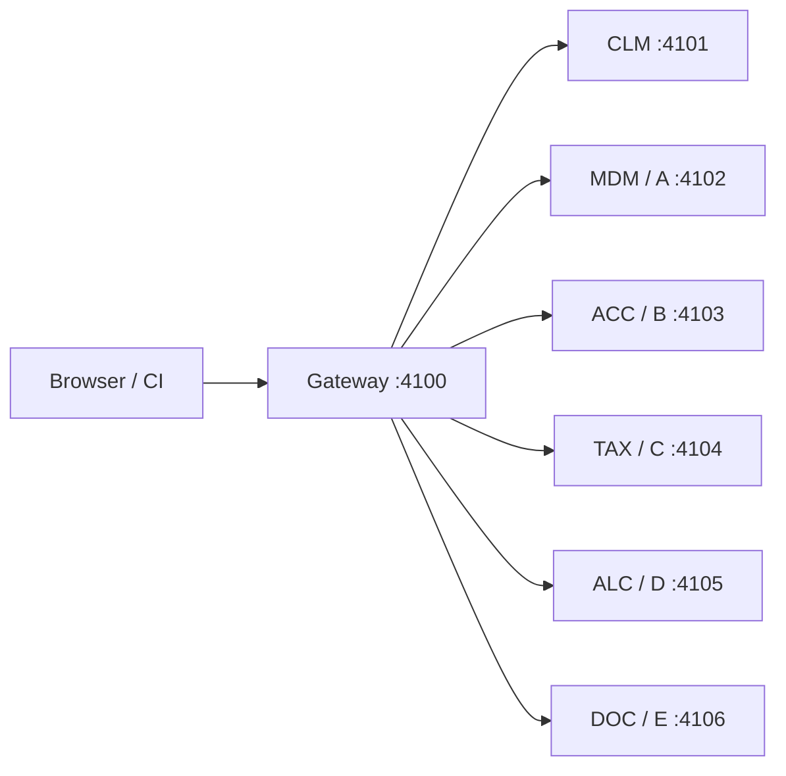
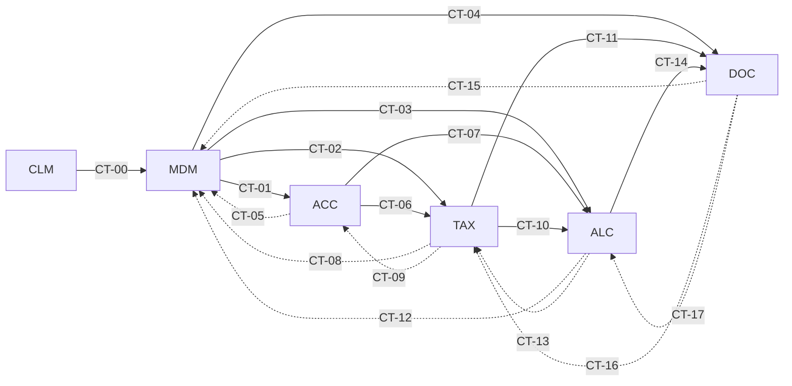
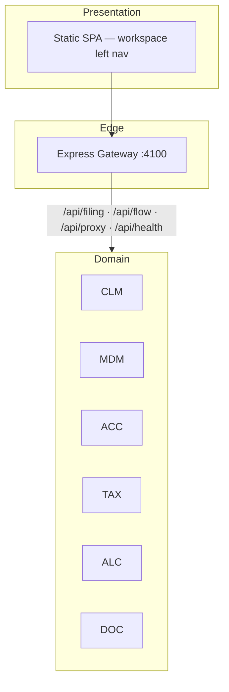

# TaxMesh — Application & Microservice Architecture

**System:** TaxMesh US Partnership Form 1065 demo  
**Pattern:** Six separate microservices — **CLM · MDM · ACC · TAX · ALC · DOC**  
**Guide:** [TaxMesh_API_Architecture_and_Developer_Guide.md](TaxMesh_API_Architecture_and_Developer_Guide.md) · `.docx` download from UI / `docs/`

Legacy aliases: CEM→CLM, MAD→MDM, CAM→ACC, TIM→TAX, RPAM→ALC, FORMS→DOC.

---

## 1. Platform overview

TaxMesh supports an upload-driven Form **1065** filing journey:

**CLM → MDM → ACC → TAX → ALC → DOC / E-file**

The gateway (`:4100`) hosts the SPA, filing orchestration (`/api/filing/*`), data-flow APIs (`/api/flow/*`), service proxy (`/api/proxy/{CLM|MDM|ACC|TAX|ALC|DOC|A|B|C|D|E}/…`), health, architecture, and Swagger.

**Letter aliases:** A = MDM · B = ACC · C = TAX · D = ALC · E = DOC. CLM has no letter alias.

---

## 2. Domain services

| Service | Letter | Port | Workspace / role |
|---------|--------|------|------------------|
| **CLM** | — | 4101 | Client Management — engagement, project, entity group, job, **entity name** |
| **MDM** | A | 4102 | Master Data — legal entity, partners, ownership, SALT |
| **ACC** | B | 4103 | Accounting — trial balance / chart of accounts |
| **TAX** | C | 4104 | Tax Computation — federal/state calc + business validation |
| **ALC** | D | 4105 | Allocations — partner K-1 amounts + business validation |
| **DOC** | E | 4106 | Forms & Documents — 1065 / K-1 package + MeF |

### Upload-driven data flow

1. **Upload CLM + MDM** (`clm.xlsx`, `mdm.xlsx`) → available to **ACC** and **TAX**.  
2. **Upload ACC** (`acc.xlsx`) → joins CLM + MDM, then feeds **TAX** and **ALC**.  
3. **TAX + ALC calculate** (with business validation) → **DOC**.

ACC upload automatically runs **TAX → ALC → DOC**.  
**Reset** clears the engagement banner and all upload state (no leftover demo seed).

### Downstream vs upstream APIs

| Direction | Meaning | Example |
|-----------|---------|---------|
| **Downstream** | Journey-forward contracts | MDM → TAX (`CT-02`) |
| **Upstream** | Reverse / feedback asks (`direction: reverse` in catalog) | TAX → MDM (`CT-08`) |

Catalog: `GET /api/flow` · Pair: `GET /api/flow/downstream/{from}/{to}` · Per service: `GET /api/proxy/{svc}/flow`

---

## 3. Contract matrix (CT-00 … CT-17)

| ID | Producer → Consumer | Direction | Purpose |
|----|---------------------|-----------|---------|
| CT-00 | CLM → MDM | Downstream | Engagement / project / job context |
| CT-01 | MDM → ACC | Downstream | Entities for account mapping |
| CT-02 | MDM → TAX | Downstream | Entity tax attributes |
| CT-03 | MDM → ALC | Downstream | Partner ownership |
| CT-04 | MDM → DOC | Downstream | Filing metadata |
| CT-05 | ACC → MDM | Upstream | Missing entity / account codes |
| CT-06 | ACC → TAX | Downstream | Book account balances |
| CT-07 | ACC → ALC | Downstream | Capital account mappings |
| CT-08 | TAX → MDM | Upstream | Tax attribute corrections |
| CT-09 | TAX → ACC | Upstream | Book-to-tax reconciling asks |
| CT-10 | TAX → ALC | Downstream | Taxable income buckets |
| CT-11 | TAX → DOC | Downstream | Tax computation summary |
| CT-12 | ALC → MDM | Upstream | Ownership validation issues |
| CT-13 | ALC → TAX | Upstream | Adjusted tax amount needs |
| CT-14 | ALC → DOC | Downstream | Partner allocation / K-1 |
| CT-15 | DOC → MDM | Upstream | Legal name / EIN for forms |
| CT-16 | DOC → TAX | Upstream | Tax line amounts for forms |
| CT-17 | DOC → ALC | Upstream | Partner capital restatement |

Solid = downstream · Dashed = upstream (reverse).

---

## 4. Runtime architecture

Each domain service exposes:

| Endpoint | Purpose |
|----------|---------|
| `GET /health` | Liveness + produced/consumed CT IDs |
| `GET /contracts` | Catalog for this service |
| `GET /contracts/downstream` · `/contracts/upstream` | Direction-scoped lists |
| `GET /flow` | Peers + contracts summary |
| `GET /downstream/{peer}` · `/upstream/{peer}` | Payloads to a peer |
| `GET /consume/downstream` · `/consume/upstream` | Batch pull |
| `GET /contracts/ct-XX/...` | Producer payload |
| `GET /consume/:contractId` | Pull one consumed contract |
| `GET /pipeline?direction=` | Reachability of consumed producers |

**Excel upload (CLM / MDM / ACC):** `POST /upload`  
**Business validation (TAX / ALC):** `GET|POST /validate`, `POST /calculate` (TAX), `POST /allocate` (ALC)

Shared modules: `shared/contracts.js`, `flowApis.js`, `payloads.js`, `filingEngine.js`, `businessValidation.js`, `dataFlow.js`, `excelImport.js`, `createService.js`.

---

## 5. Quality gates (AQG1–AQG5)

| Gate | Boundary |
|------|----------|
| AQG1 | CLM → MDM context & master data |
| AQG2 | MDM/ACC → TAX inputs synced |
| AQG3 | TAX calculation complete & reconciled |
| AQG4 | ALC → DOC artifacts ready |
| AQG5 | Full business transaction / MeF |

---

## 6. Deployment

| Mode | Command |
|------|---------|
| Local | `npm start` (6 services + gateway) |
| Contract checks | `npm run test:contracts` |
| Regenerate Excel | `npm run generate:excel` |
| Docker Compose | `docker compose up --build` |

UI: http://127.0.0.1:4100 · Swagger: http://127.0.0.1:4100/api-docs · Flow: http://127.0.0.1:4100/api/flow

Behind a tunnel, Swagger uses **same-origin** server URLs (`/`). Set `PUBLIC_BASE_URL` if you need an absolute public host in OpenAPI.
